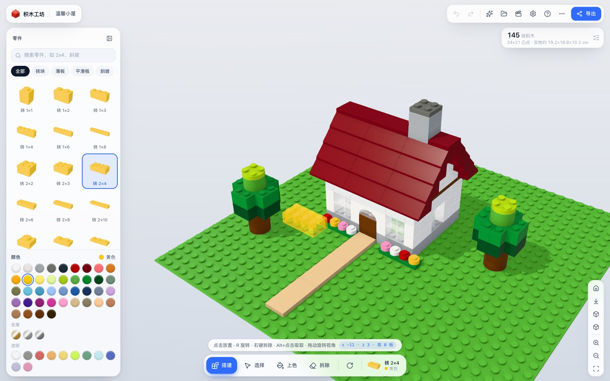
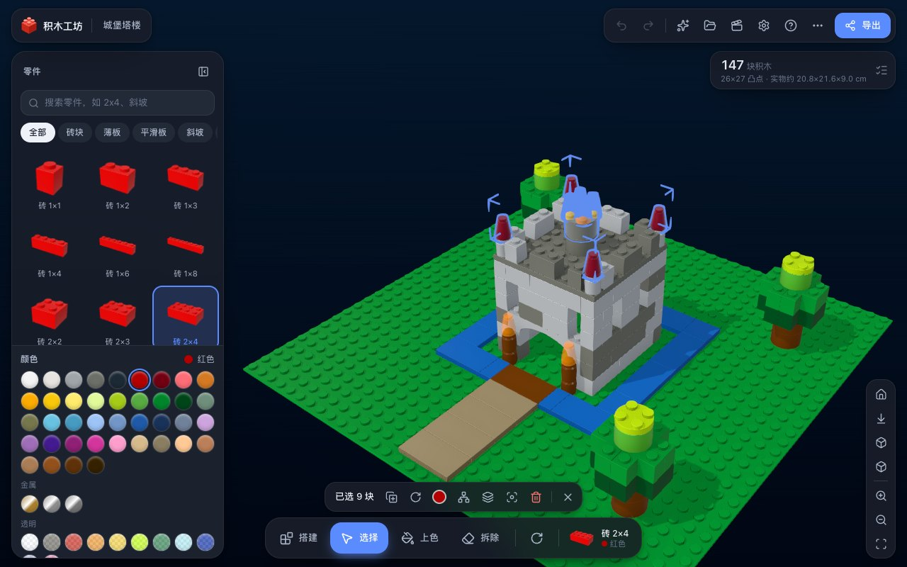
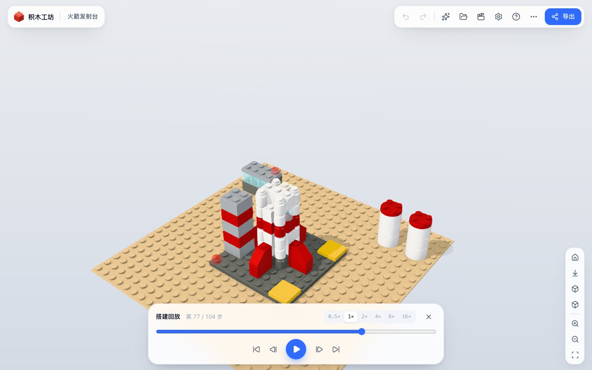
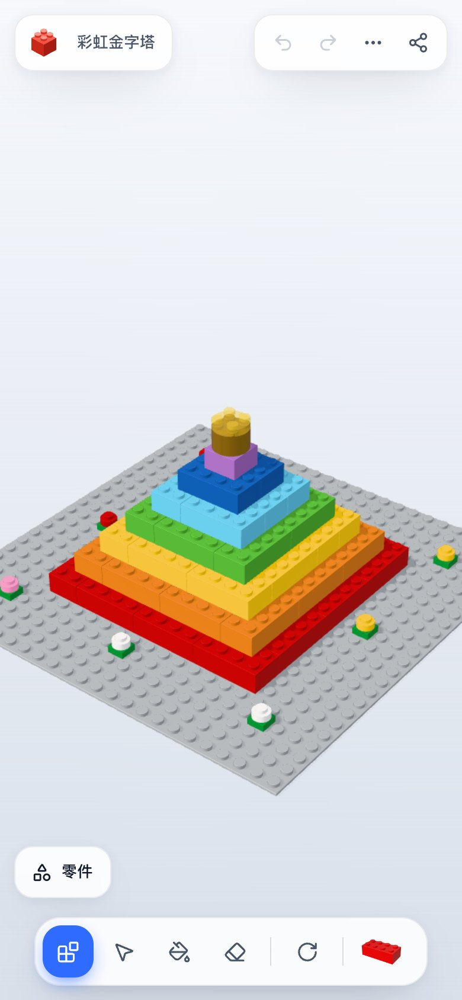

# 积木工坊 · BrickLab

> 在浏览器里自由搭建 3D 积木作品的乐高风格模拟器。零安装、离线可用、作品自动保存。



<table>
  <tr>
    <td width="44%"></td>
    <td width="38%"></td>
    <td width="18%"></td>
  </tr>
  <tr>
    <td align="center">深色主题 · 选区描边</td>
    <td align="center">搭建回放</td>
    <td align="center">手机端</td>
  </tr>
</table>

## ✨ 亮点

- **以假乱真的积木**：程序化生成的空心积木（带圆角、凸点、底部管/销），物理材质 + 摄影棚环境光 + 软阴影 + 环境光遮蔽（N8AO），透明件、金属件各有质感。
- **几千块也流畅**：按「零件 × 材质」实例化渲染，2800 块积木在 Apple M 系列芯片上仍稳定 60 FPS（开启环境光遮蔽）；体素 DDA 射线拾取每次仅约 0.01 ms。
- **上手即会**：点击放置、R 旋转、右键拆除、Alt+点击吸取；放置预览会自动吸附网格、贴面、遇到障碍自动抬升。
- **完整的编辑能力**：选择 / 多选 / 框选、双击选中相连积木、拖动移动、方向键微调、复制粘贴、整组旋转、上色、无限撤销重做。
- **57 种零件 · 54 种官方颜色**：砖、板、平滑板、斜坡、反斜坡、圆砖、圆锥、转角砖、拱门、高砖……颜色编号直接采用 LDraw 官方色表。
- **与真实世界接轨**：
  - 导出 **LDraw (.ldr)**，可在 BrickLink Studio、LDCad、LDView 中打开（已用官方零件文件逐一核对坐标与朝向）；
  - 导入 **.ldr / .mpd**（自动展开子模型、识别旧零件编号）；
  - 导出 **BrickLink 采购清单 XML** 和 **CSV 零件清单**，可以照着买实体积木。
- **分享与保存**：整个作品压缩进一个链接发给朋友；「我的作品」本地自动保存（IndexedDB）并生成缩略图；高清 / 透明背景截图。
- **搭建回放**：按层逐块重现搭建过程，像一本动态说明书。
- **示例作品**：温馨小屋、红色小飞机、城堡塔楼、火箭发射台、像素爱心、彩虹金字塔，一键载入后可以随意改造。
- **贴心细节**：浅色 / 深色主题、中英双语、合成的「咔哒」音效、手机与平板触控（长按拆除）、拖放文件打开、可安装为 PWA 离线使用。

## 🚀 快速开始

需要 Node.js 20+（开发时使用 Node 24）。

```bash
npm install
npm run dev        # 本地开发 http://localhost:5173
npm run build      # 类型检查 + 生产构建，输出到 dist/
npm run preview    # 预览生产构建
```

`dist/` 是纯静态文件（`base: './'`），可以直接部署到任意静态托管；部署在 HTTPS 下时可以「安装」为桌面/手机应用并离线使用。

想直接发给朋友？运行 `npm run build:single`，会得到一个约 1.2 MB 的 `dist-single/积木工坊.html`，所有代码都内联在里面，双击即可在浏览器中打开（无需服务器）。

## 🖱️ 操作方式

| 操作 | 说明 |
| --- | --- |
| 左键点击 | 执行当前工具：放置 / 选择 / 上色 / 拆除 |
| 左键拖动 | 旋转视角（选择工具下拖动积木 = 移动积木） |
| 右键拖动 / 滚轮 | 平移 / 朝光标缩放 |
| 右键点击 | 搭建模式下快速拆除 |
| Alt + 点击 | 吸取积木的颜色和零件 |
| Shift + 拖动 | 选择模式下框选 |
| 双击积木 | 选中与它相连的整组积木 |
| 触屏 | 单指旋转 · 双指缩放平移 · 轻点执行工具 · 长按拆除 |

### 键盘快捷键

| 按键 | 功能 |
| --- | --- |
| `B` `V` `P` `E`（或 `1`–`4`） | 搭建 / 选择 / 上色 / 拆除 |
| `R` / `Shift+R` | 旋转（待放置的积木、粘贴的副本或所选积木） |
| `Ctrl/⌘ + Z`、`Ctrl/⌘ + Shift + Z` | 撤销 / 重做 |
| `Ctrl/⌘ + C / X / V / D` | 复制 / 剪切 / 粘贴 / 创建副本 |
| `Ctrl/⌘ + A` | 全选 |
| `Delete` / `Backspace` | 删除所选 |
| 方向键 | 移动所选积木（按当前视角）；未选中时旋转视角 |
| `Shift + ↑/↓` | 所选积木升高 / 降低一板 |
| `F` / `H` / `T` | 聚焦 / 默认视角 / 俯视 |
| `[` `]` 与 `,` `.` | 切换上一个 / 下一个零件与颜色 |
| `Ctrl/⌘ + S / O / E` | 保存缩略图 / 打开文件 / 导出与分享 |
| `Esc` | 逐级取消（拖动 → 粘贴 → 选择） |
| `?` | 帮助 |

## 🧱 技术栈

| 层 | 选型 | 理由 |
| --- | --- | --- |
| 构建 | Vite 8 + TypeScript 7 | 秒级冷启动与热更新，严格类型 |
| 3D | Three.js r186（命令式引擎） | 实例化渲染、着色器注入、后期处理完全可控 |
| 画质 | N8AO + SMAA、PMREM 环境贴图、PCF 软阴影 | 积木接缝与凸点根部的接触阴影是「真实感」的关键 |
| 界面 | React 19 + Tailwind CSS 4 + lucide 图标 | 组件化的毛玻璃界面，主题由 CSS 变量驱动 |
| 状态 | Zustand + 纯 TS 模型类 | 模型与渲染、界面解耦，便于测试 |
| 存储 | IndexedDB（idb-keyval） | 本地作品库，隐私模式下自动退回内存 |
| 测试 | Vitest + Playwright | 核心逻辑单元测试 + 真实鼠标键盘的端到端冒烟测试 |

## 🏗️ 架构

```
src/
├── core/            纯逻辑（无 DOM / three.js 依赖，可单测）
│   ├── parts.ts       零件目录、旋转与占位体素
│   ├── colors.ts      LDraw 官方颜色 + BrickLink 映射
│   ├── grid.ts        体素占位表（碰撞检测）
│   ├── model.ts       作品模型：补丁式撤销/重做、事件
│   ├── placement.ts   DDA 射线拾取、放置吸附、整组旋转、相连检测
│   ├── serialize.ts   作品文件 / 分享链接（二进制 + deflate + base64url）
│   ├── ldraw.ts       LDraw 导出与导入（含 MPD 子模型展开）
│   ├── bom.ts         零件清单、CSV、BrickLink XML
│   └── templates.ts   示例作品（程序化生成）
├── engine/          渲染与交互
│   ├── Engine.ts      场景、相机、灯光、后期、渲染循环（按需渲染）
│   ├── geometry.ts    程序化积木几何体（截面扫掠 / 旋转体 / 棱柱）
│   ├── bricks.ts      实例化批次管理、逐实例高亮属性
│   ├── materials.ts   物理材质 + 着色器注入的高亮
│   ├── interaction.ts 指针交互：预览、放置、拖动、框选、粘贴
│   ├── outline.ts     选区描边（恒定像素宽度的反向外壳）
│   ├── ghost.ts / animator.ts / sound.ts / thumbnails.ts …
├── state/           Zustand 状态、动作、快捷键、持久化
├── ui/              React 组件（面板、工具坞、对话框…）
└── i18n/            中英文案
```

几个关键设计：

- **网格坐标**：水平以凸点（8 mm）为单位，竖直以板高（3.2 mm）为单位；砖 = 3 板。所有碰撞、拾取、放置都在整数体素上完成，杜绝浮点误差。
- **拾取不碰三角形**：射线直接在体素网格中做 Amanatides–Woo 遍历，法线天然轴对齐，侧面贴放、顶面叠放、底面悬挂都由命中面决定。
- **按需渲染**：只有相机移动、动画或内容变化时才渲染；阴影贴图只在积木变化时更新，旋转视角不重算阴影。
- **LDraw 精确对位**：单元测试把官方零件文件中的凸点坐标按导出矩阵变换，验证与本项目渲染的凸点位置在四个朝向下完全重合（斜坡原点在凸点排、转角件需额外旋转等细节都已处理）。

## 🧪 测试

```bash
npm test           # 单元测试（零件、碰撞、撤销、拾取、序列化、LDraw 往返、示例作品…）
npm run dev        # 另开终端
npm run e2e        # 端到端冒烟测试：真实鼠标键盘操作 + 截图（需要本机安装 Chrome）
node scripts/e2e-io.mjs        # 自动保存恢复、分享链接、LDraw 导出再导入、截图导出
node scripts/docs-shots.mjs    # 重新生成 README 截图
```

离线能力可以这样验证：`npm run build && npx vite preview`，然后 `node scripts/offline-check.mjs http://localhost:4173/`。

## 📦 文件格式

- **作品文件 `.brick.json`**：`{ format: "brick-lab", version: 1, name, baseplate, bricks: [[零件, 颜色, x, y, z, 朝向], …] }`
- **分享链接**：`#m=` 后为 deflate 压缩的二进制（每块积木 10 字节），500 块积木通常只有几 KB。

---

LEGO® 是乐高集团的商标，本项目为个人爱好作品，与乐高集团无关。零件编号与颜色数据来自 [LDraw](https://www.ldraw.org/) 与 BrickLink 的公开资料。
